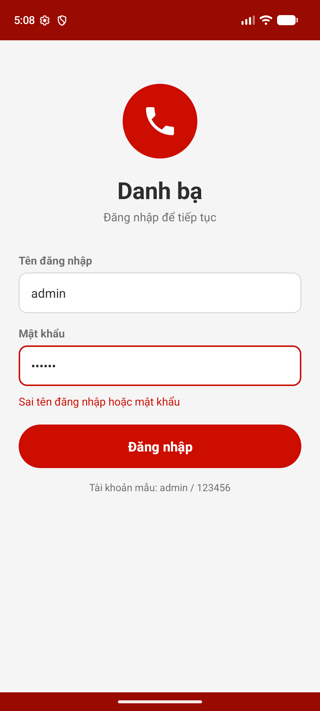
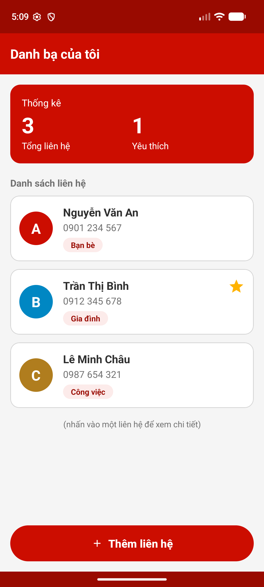
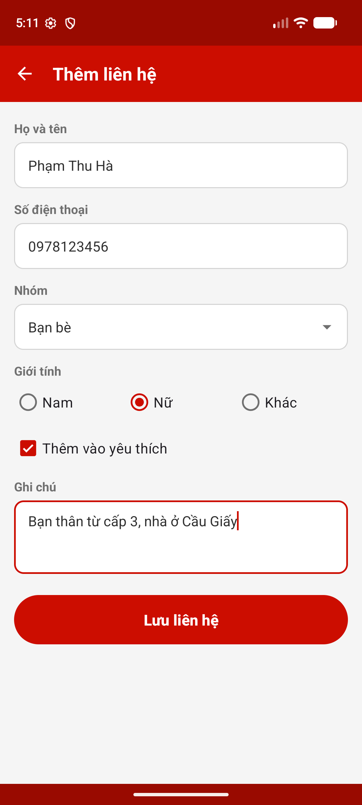
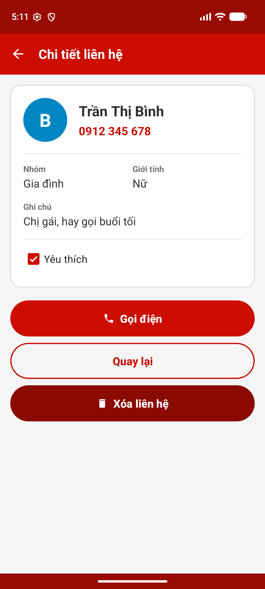
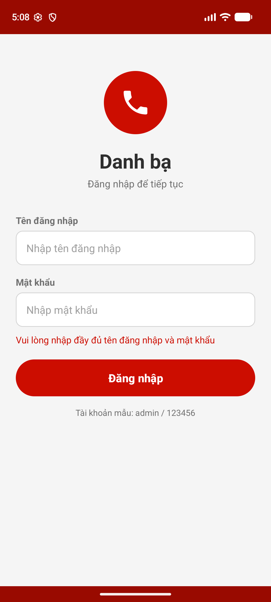
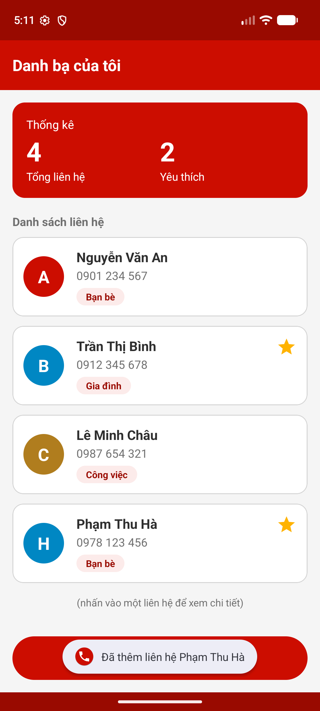
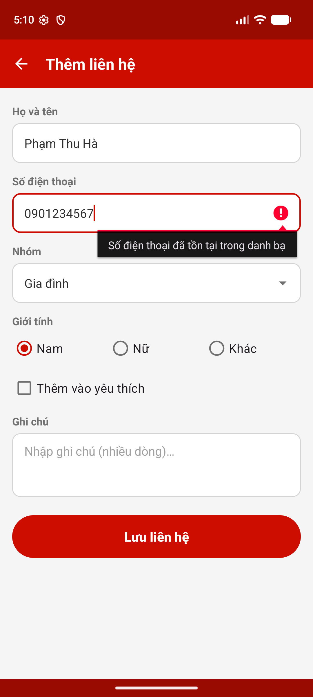
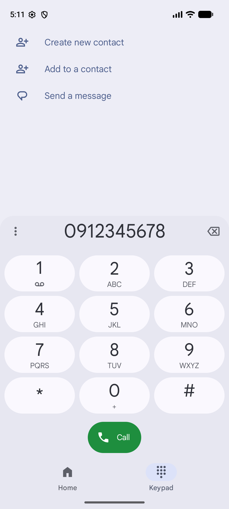

# Ứng dụng Quản lý danh bạ liên hệ (Android – Java)

Bài tập Lập trình Android: ứng dụng lưu trữ và quản lý danh bạ, gồm 4 màn hình **Đăng nhập → Danh sách liên hệ → Thêm liên hệ / Chi tiết liên hệ**.

- **Sinh viên:** Nguyễn Duy Tú – **MSSV:** B24DCCC275
- **Báo cáo:** [B24DCCC275_NguyenDuyTu_BaoCao.docx](B24DCCC275_NguyenDuyTu_BaoCao.docx)

## Chức năng

| Màn hình | Chức năng chính |
|---|---|
| `LoginActivity` | Đăng nhập bằng tài khoản cố định `admin / 123456`; báo lỗi khi bỏ trống hoặc nhập sai; đúng thì chuyển sang danh sách và `finish()` để nút Back không quay lại. |
| `MainActivity` | Khối thống kê (tổng số liên hệ, số liên hệ yêu thích); danh sách `RecyclerView` (ảnh đại diện chữ cái đầu của tên, họ tên, số điện thoại, nhóm, dấu sao); nút Thêm liên hệ. |
| `AddContactActivity` | Nhập họ tên, số điện thoại, nhóm (`Spinner`), giới tính (`RadioGroup`), yêu thích (`CheckBox`), ghi chú nhiều dòng; kiểm tra họ tên trống, số điện thoại 10 chữ số bắt đầu bằng 0 và không trùng. |
| `ContactDetailActivity` | Xem đầy đủ thông tin; gọi điện bằng Intent ngầm định `ACTION_DIAL`; đổi trạng thái yêu thích; quay lại; xóa liên hệ (có hỏi xác nhận). |

Dữ liệu được quản lý bằng `ArrayList<Contact>` trong bộ nhớ (không dùng SQLite/Room/Firebase). Các màn hình chuyển và truyền dữ liệu cho nhau bằng `Intent` (lớp `Contact` cài đặt `Serializable`), kết quả trả về được nhận bằng Activity Result API.

## Công nghệ

- Java, giao diện XML, Android Studio
- `compileSdk`/`targetSdk` 37, `minSdk` 24 (Android 7.0 trở lên)
- AndroidX AppCompat, Material Components, RecyclerView, ConstraintLayout
- Gradle 9.5.0, Android Gradle Plugin 9.3.3

## Cấu trúc mã nguồn

```
app/src/main/
├── java/com/nguyenduytu/quanlydanhba/
│   ├── Contact.java                 # Lớp liên hệ: họ tên, SĐT, nhóm, giới tính, yêu thích, ghi chú
│   ├── LoginActivity.java           # Màn hình 1: Đăng nhập
│   ├── MainActivity.java            # Màn hình 2: Danh sách + thống kê
│   ├── ContactAdapter.java          # Adapter của RecyclerView
│   ├── AddContactActivity.java      # Màn hình 3: Thêm liên hệ
│   └── ContactDetailActivity.java   # Màn hình 4: Chi tiết liên hệ
└── res/
    ├── layout/                      # activity_*.xml, item_contact.xml, item_spinner*.xml
    ├── layout-land/activity_main.xml  # Bố cục danh sách khi xoay ngang
    ├── drawable/                    # Icon vector, nền ô nhập, nền tròn ảnh đại diện...
    └── values/                      # strings.xml, colors.xml, themes.xml
app/src/test/.../ContactTest.java    # Unit test cho lớp Contact
```

## Cách chạy

1. Mở Android Studio → **File › Open** → chọn thư mục project này, chờ Gradle Sync xong.
2. Chọn máy ảo hoặc điện thoại (Android 7.0+), nhấn **Run ▶**.
3. Đăng nhập bằng tài khoản `admin` / `123456`.

Chạy unit test: `./gradlew testDebugUnitTest` (Windows: `gradlew.bat testDebugUnitTest`).

## Ảnh chụp màn hình

| Đăng nhập | Danh sách | Thêm liên hệ | Chi tiết |
|---|---|---|---|
|  |  |  |  |
|  |  |  |  |

Toàn bộ ảnh chụp nằm trong thư mục [`screenshots/`](screenshots/).
